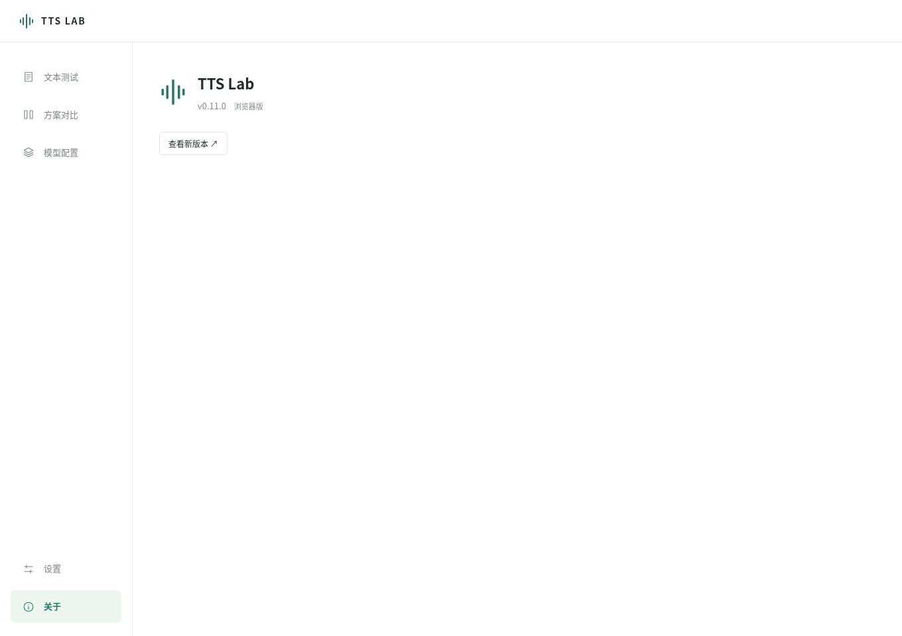
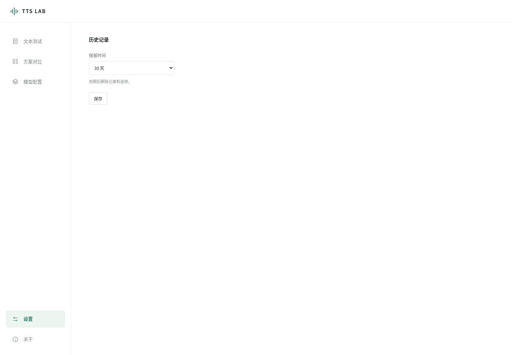

# TTS Lab: Local Text-to-Speech Comparison Workbench

[简体中文](README.md) | English

## Overview

TTS Lab is a text-to-speech workbench that runs on your computer. Enter text, choose engines, voices, and settings, then test a single configuration or compare multiple configurations with blind listening and audio/settings exports. A Windows desktop edition is available, and the source version runs in a browser.

## Features

- **Listen directly and save configurations**: Start from an optional preset or enter settings directly. Listen synthesizes and plays automatically, reuses matching completed audio, and supports save and save-as. Compare up to 6 per batch, including different voices and settings from the same engine.
- **Cloud service adapters**: Integrates adapters for OpenAI, DeepSeek, Gemini, Qwen / DashScope, MiniMax, Xiaomi MiMo, ByteDance Doubao / Seed TTS, ElevenLabs, StepAudio, Fish Audio, Azure, Google Cloud TTS, and AWS Polly.
- **Configure credentials in the interface**: Click a cloud service card to enter your own credentials. Changes take effect immediately after saving; saved keys are never displayed.
- **Local model management**: Provides downloads and offline inference for Kokoro, Qwen3-TTS, CosyVoice, IndexTTS-2, and GLM-TTS, with installation cancellation and model deletion. IndexTTS-2 and GLM-TTS accept reference recordings; GLM-TTS also requires a transcript.
- **Independent settings**: Select configured, ready cloud services or installed local models, then adjust voices, speech rate, pitch, or style instructions according to each engine's capabilities. Includes Chinese, English, and mixed-language test texts.
- **Blind listening**: Randomize sample order and hide configuration identities to compare voices directly.
- **Generation metrics**: View generation time and file size. WAV output also provides audio duration and the real-time factor (RTF).
- **History and downloads**: Always-visible history shows 10 complete listening batches per page and restores text, models, and settings. The Download audio button saves a ZIP containing audio and settings.
- **Version and desktop updates**: View the current version and check for or download updates on the About page, then install and restart after verification. Personal settings, models, and history are preserved.
- **Retention settings and minimal interface**: Sidebar navigation, matching editor heights, and a compact player. Settings controls history retention, defaulting to 30 days, with a keep-forever option. Expired records and audio are removed; presets, credentials, models, and reference recordings remain.

## Screenshots

Screenshots show the Chinese interface.

### Text Input and Configuration Comparison

### Local Model Management

### Playback Results and Exports

This offline test-tone demo shows audio playback, generation metrics, and export controls.

### About and App Updates

### History Retention Settings

History defaults to 30 days, with other durations and a keep-forever option.

