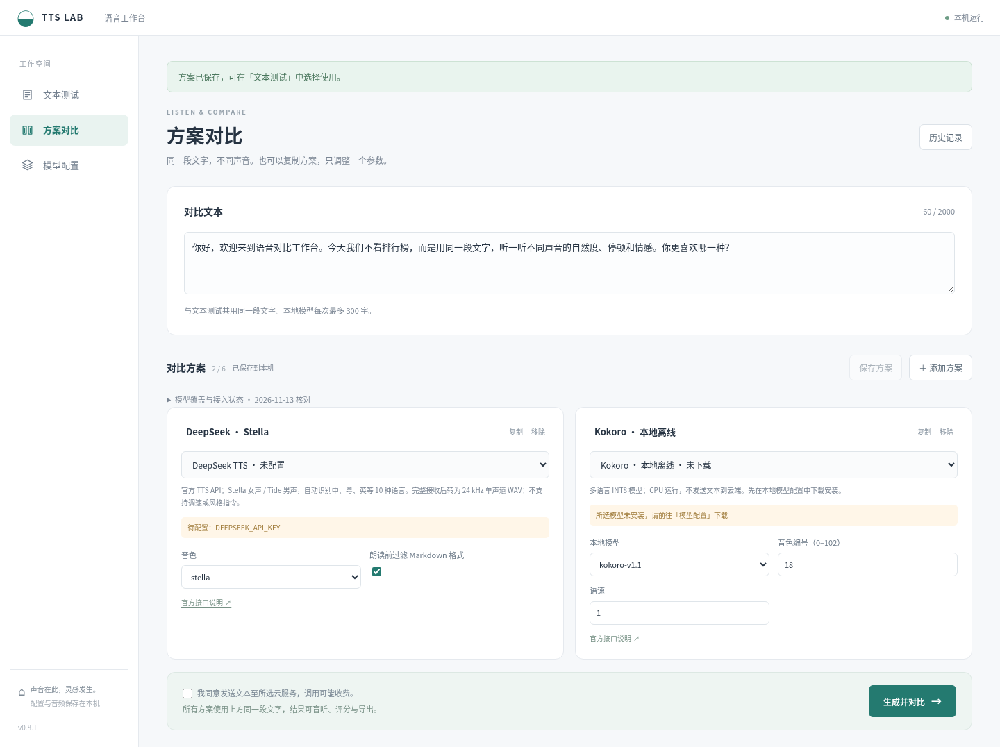
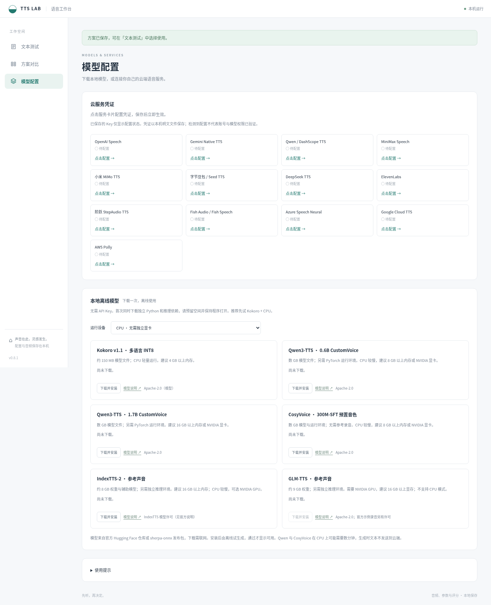
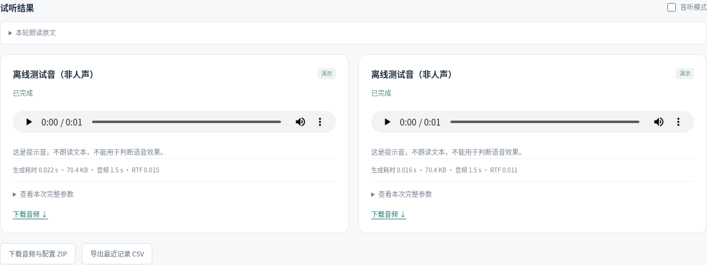

# TTS Lab: Local Text-to-Speech Comparison Workbench

[简体中文](README.md) | English

## Overview

TTS Lab is a text-to-speech workbench that runs on your computer. Enter text, choose engines, voices, and settings, then test a single configuration or compare multiple configurations with blind ratings and result exports. A Windows desktop edition is available, and the source version runs in a browser.

## Features

- **Save and compare configurations**: Name and save configurations for repeated single-configuration tests. Compare up to 6 per batch, including different voices and settings from the same engine.
- **Cloud service adapters**: Integrates adapters for OpenAI, DeepSeek, Gemini, Qwen / DashScope, MiniMax, Xiaomi MiMo, ByteDance Doubao / Seed TTS, ElevenLabs, StepAudio, Fish Audio, Azure, Google Cloud TTS, and AWS Polly.
- **Configure credentials in the interface**: Click a cloud service card to enter your own credentials. Changes take effect immediately after saving; saved keys are never displayed.
- **Local model management**: Provides downloads and offline inference for Kokoro, Qwen3-TTS, CosyVoice, IndexTTS-2, and GLM-TTS, with installation cancellation and model deletion. IndexTTS-2 and GLM-TTS accept reference recordings; GLM-TTS also requires a transcript.
- **Independent settings**: Adjust models, voices, speech rate, pitch, or style instructions according to each engine's capabilities. Includes Chinese, English, and mixed-language test texts.
- **Blind listening and subjective ratings**: Randomize sample order and hide configuration identities. Rate naturalness, pronunciation accuracy, emotional expression, and suitability for your use case, and add listening notes.
- **Generation metrics**: View generation time and file size. WAV output also provides audio duration and the real-time factor (RTF).
- **Local history and exports**: Save text, settings, audio, and ratings locally. Revisit previous comparisons, download individual audio files, export a batch as ZIP, or export records as CSV.
- **Desktop updates**: Check for and download updates in the app, then install and restart after verification. Personal settings, models, and history are preserved.
- **Offline workflow demo**: Try playback and export with test tones without credentials. Test tones do not read the input text and cannot be used to evaluate speech quality.

## Screenshots

Screenshots show the Chinese interface.

### Text Input and Configuration Comparison

### Local Model Management

### Playback Results and Exports

This offline test-tone demo shows audio playback, generation metrics, and export controls.

