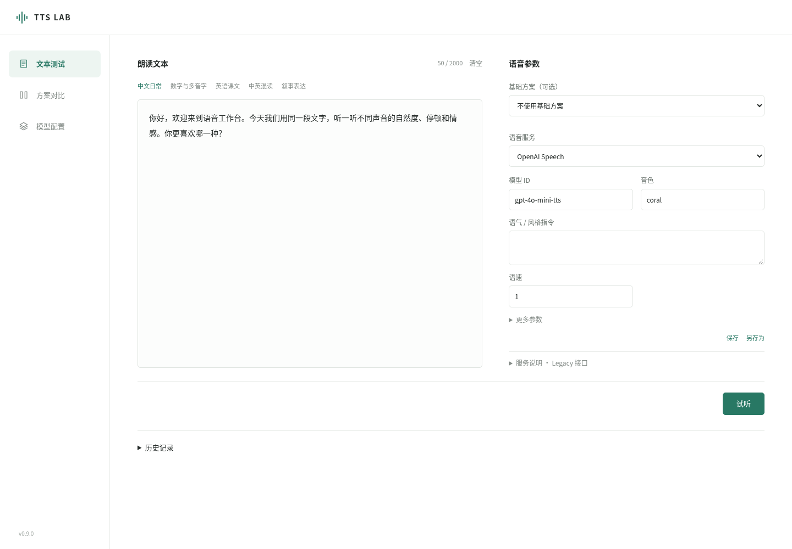
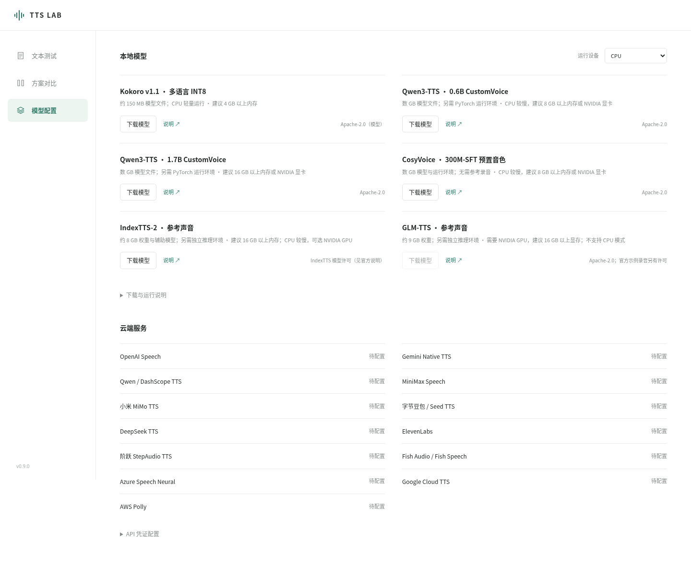
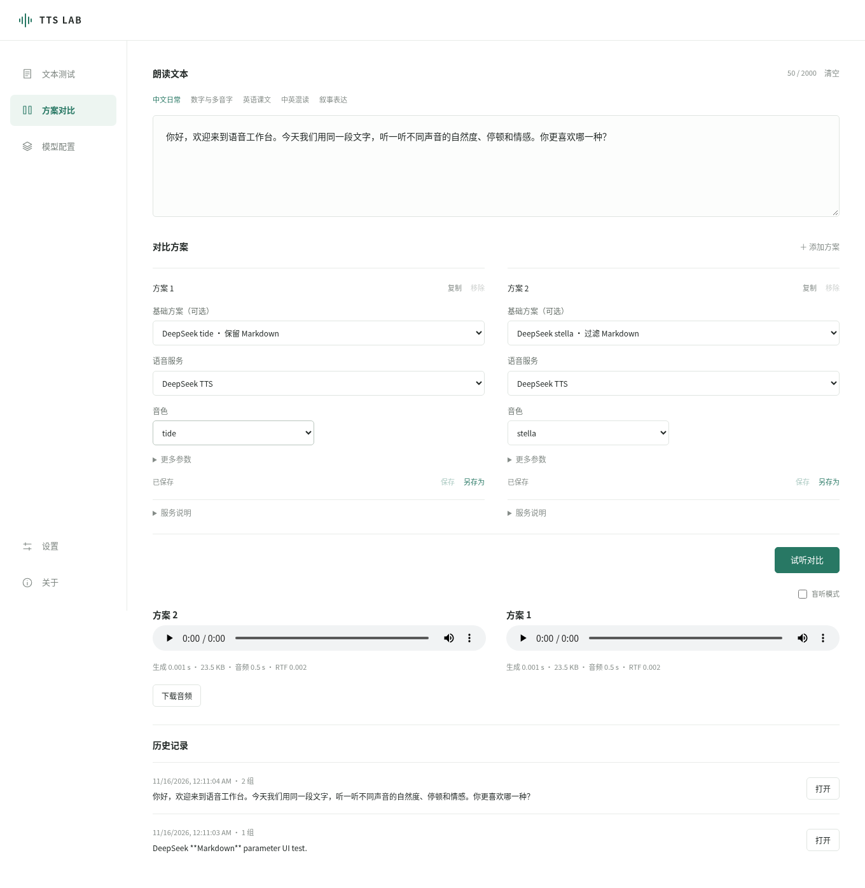

# TTS Lab

[简体中文](README.md) | English | [Download for Windows](https://github.com/whoarei/tts-lab/releases/latest)

A local text-to-speech and voice comparison tool supporting cloud services and local models. Available as a Windows desktop app or from source in a browser.

## Features

- **Direct listening**: Adjust models, voices, and parameters, synthesize and play automatically, and reuse existing audio.
- **Presets and comparison**: Save, edit, or duplicate configurations. Compare up to six at once, with blind listening.
- **Cloud services**: Adapters for OpenAI, DeepSeek, Gemini, Qwen, and others, with in-app credential configuration.
- **Local models**: Manage Kokoro, Qwen3-TTS, CosyVoice, IndexTTS-2, and GLM-TTS, including reference recordings.
- **Metrics**: View generation time, audio duration, file size, and real-time factor.
- **History**: Browse paginated records and restore text and parameters. Retention defaults to 30 days, with a keep-forever option.
- **Downloads**: Save a ZIP containing the batch's audio and parameters.
- **Updates**: View the version and check for or install updates on the About page.

## Screenshots

Screenshots show the Chinese interface.

### Text Testing

Enter text, adjust parameters, and listen directly.

### Model Configuration

Manage local models and cloud service credentials.

### Configuration Comparison

Compare voices and download audio with parameters. The screenshot uses mock audio.

More screenshots: [History retention](docs/screenshots/settings.png) · [Version and updates](docs/screenshots/about.png)
