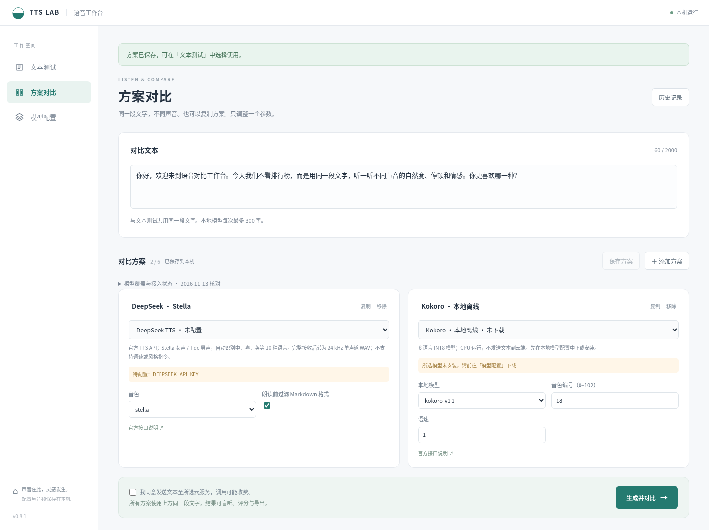
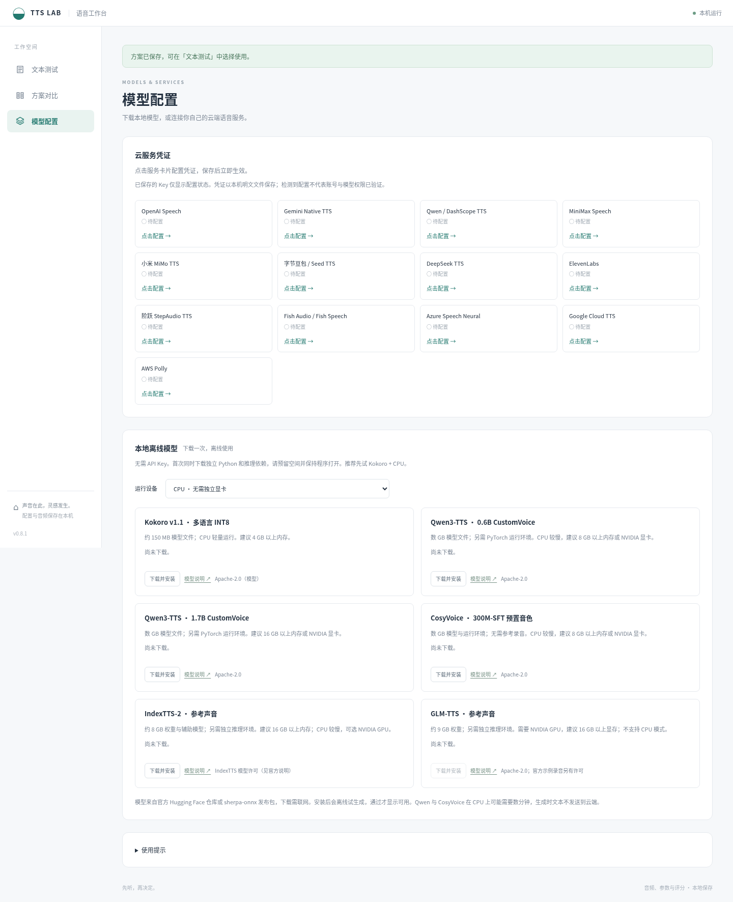
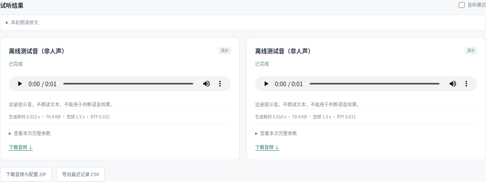

# TTS Lab：本地语音对比工作台

简体中文 | [English](README.en.md)

## 软件简要说明

TTS Lab 是一款在本机运行的语音合成工作台。输入文本，选择引擎、音色和参数，进行单方案测试或多方案对比，支持盲听评分与结果导出。提供 Windows 桌面版，也可从源码在浏览器中运行。

## 软件特性列表

- **方案保存与对比**：命名并保存方案，重复用于单方案测试；每轮最多对比 6 组，可复制同一引擎比较音色与参数。
- **多家云服务适配**：集成 OpenAI、DeepSeek、Gemini、Qwen / DashScope、MiniMax、小米 MiMo、字节豆包 / Seed TTS、ElevenLabs、StepAudio、Fish Audio、Azure、Google Cloud TTS 和 AWS Polly 适配器。
- **界面配置凭证**：点击云服务卡片填写自己的凭证，保存后立即生效；已保存的 Key 不回显。
- **本地模型管理**：提供 Kokoro、Qwen3-TTS、CosyVoice、IndexTTS-2 和 GLM-TTS 的模型下载与离线推理入口，支持取消安装和删除模型。IndexTTS-2 与 GLM-TTS 支持导入参考录音，GLM-TTS 还需逐字稿。
- **独立参数配置**：按引擎调整模型、音色、语速、音高或风格指令，内置中文、英文、中英混读等测试文本。
- **盲听与主观评分**：随机排列并隐藏方案身份，记录自然度、读音准确、情感表达和场景适合度四项评分及听感笔记。
- **生成指标展示**：查看生成耗时、文件大小；WAV 音频还可展示时长与实时率（RTF）。
- **本地记录与导出**：保存文本、参数、音频和评分，支持历史回看、单条音频下载、整轮 ZIP 打包及 CSV 导出。
- **桌面在线更新**：在应用内检查、下载更新，校验后安装并重启，保留个人配置、模型和历史。
- **离线流程演示**：无需凭证即可用提示音体验播放与导出流程；提示音不朗读文本，不用于评价语音质量。

## 软件主要功能截图

### 文本输入与方案对比

### 本地模型管理

### 试听结果与导出

以下为离线提示音演示，展示音频播放、生成指标和导出入口。

